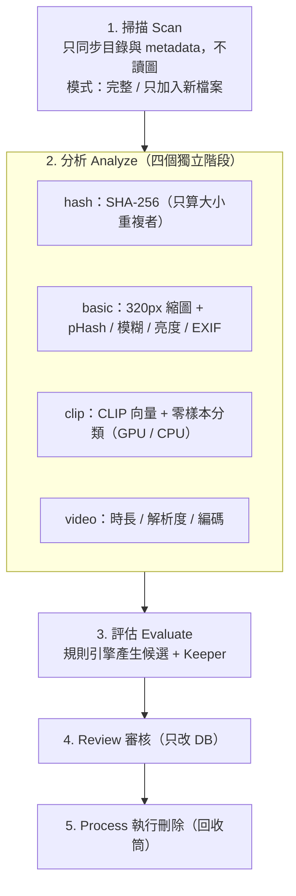

# 相片清理助手 (Photo Cleaner)

[繁體中文](#zh-tw) | [English](#en)

---

<a id="zh-tw"></a>

## 🇹🇼 繁體中文

本地運行的相片庫清理工具，針對大型相片庫（約 10 萬張、300GB，可放在 NAS）設計。
以 SHA-256、pHash、清晰度 / 亮度與 **CLIP 零樣本分類**找出完全重複、近似重複、連拍多餘、模糊、曝光不良、螢幕截圖、文件 / 收據、梗圖與誤拍相片；
在審核工作台人工確認後，批次移至資源回收筒。

目前版本：**v0.6.4**。各版本變更見 `CHANGELOG-v0.5.md`、`CHANGELOG-v0.6.md` … `CHANGELOG-v0.6.4.md`；
規格書仍是 [`photo-cleaner-functional-spec-0.4.md`](photo-cleaner-functional-spec-0.4.md)，與較新變更紀錄不一致時，**以變更紀錄為準**。

### 🛡️ 核心防護原則

1. **只有「執行刪除」頁能動實體檔案**：審核、設定等頁面只改資料庫狀態。
2. **預設移至資源回收筒**（`send2trash`）。介面一律使用資源回收筒；永久刪除只能透過 API，且必須帶 `confirm_text: "永久刪除"`；隔離資料夾模式尚未實作，後端會拒絕。
3. **Keeper 保護**：完全重複 / 近似重複 / 連拍群組加入待刪時，後端強制至少保留一張。
   **例外**：螢幕截圖與文件 / 收據不受此保護（在審核頁該分類加入待刪，或對這兩個分類做批次處理時，整個群組都可以加入待刪）。
4. **配對檔案視為同一資產**：Live Photo（HEIC/JPG + MOV）與 RAW + JPG 一起處理。
5. **完全本地**：後端只綁定 `127.0.0.1`，只接受本機 Host，拒絕其他網站來源的寫入請求，無遙測。

### ⚠️ NAS 注意事項

- `send2trash` 在網路磁碟 / UNC 路徑上通常不會進 Windows 資源回收筒（可能直接刪除）。是否會進 NAS 自己的回收筒，取決於該分享資料夾的設定。**請先用一張測試檔案確認**。
- 「NAS 上的安全刪除」（隔離資料夾 + 還原、配對檔刪到一半的處理）尚未完成（Phase 5）。在此之前，不建議用「執行刪除」頁刪除 NAS 上的相片。

### 🔄 處理流程

掃描、分析、評估三段各自獨立，可單獨執行；Library 頁的「一鍵流水線」會依序執行**掃描 → 全部分析 → 評估**（掃描與分析期間可取消，評估無法中途取消，通常數秒完成）。



- **評估狀態追蹤**：相片庫、分析結果、會影響評估的設定都沒變時，評估會自動略過；有變更時，首頁與資料庫頁會提示「需要重新評估」，並顯示上次評估新增 / 移除了幾張。
- **審核動作不會讓評估過期**（待刪 / 保留只是狀態）。

#### 💡 NAS 上的 I/O

- **basic** 階段每張相片只解碼一次（JPEG 以 draft 降解析度解碼；RAW + JPG 直接用伴生 JPG；RAW 取內嵌預覽），同時寫縮圖與計算特徵。這一段會產生網路 I/O。
- **clip** 階段優先讀取本地縮圖快取（`thumbs_cache/`）。basic 已完成時，clip 不需再讀取 NAS 原檔。

### 🖥️ 介面

| 頁面 | 用途 |
|---|---|
| 首頁總覽 | 相片庫 / 待審核 / 待刪 / 已清理四張統計卡、主要分類長條圖（每張相片只歸入一個分類，加總 = 待審核總數）、處理流程狀態 |
| 資料庫掃描 | 路徑管理、掃描、四階段分析（可單獨執行 / 重試失敗 / 補算縮圖）、評估、一鍵流水線 |
| 審核工作台 | 見下方 |
| 執行刪除 | 待刪清單、二次確認、移入資源回收筒 |
| 歷史記錄 | 歷次清理批次與明細 |
| 系統設定 | 偵測規則與門檻、分析效能（見下方） |

#### 審核工作台

- **後端分頁**：一次只載入 200 張，捲到底自動載入下一頁；統計（各分類張數 / 容量）在後端計算，10 萬筆候選也只有少量卡片在畫面上。
- **分類**：全部、螢幕截圖、文件 / 收據、梗圖、誤拍、完全重複、近似重複、連拍、模糊、曝光不良、影片；側邊欄顯示每個分類的張數與容量。一張相片可能同時符合多個分類，所以分類加總可能大於「全部」。
- **檢視**：排序（分數 / 大小 / 群組 / 路徑）、顯示或隱藏建議保留的相片、AI 分類的分數門檻、卡片大小（3–8 欄）。
- **選取與動作**：Shift 範圍選取；「選取符合條件的全部 N 張」會在後端依條件批次處理，先預覽（張數、容量、隨機 12 張縮圖）再確認，清單在預覽後變動時會被拒絕；批次動作永遠不碰建議保留的相片。
- **復原**：每次狀態變更後可在 12 秒內復原（Ctrl+Z）。復原紀錄存在記憶體，後端重新啟動後失效。
- **側邊欄**：主選單與篩選欄都可收合成窄欄（只留圖示與數量），按 `[` 一次收合 / 展開全部（專注模式）。收合狀態會記住。

| 快速鍵 | 動作 |
|---|---|
| `D` / `K` / `R` | 加入待刪 / 排除保留 / 恢復候選 |
| `Shift` + 點選 | 範圍選取 |
| `Ctrl` + `A` | 選取已載入的相片（跳過建議保留） |
| `Ctrl` + `Z` | 復原上一個動作 |
| `Esc` | 取消選取 |
| `[` | 收合 / 展開所有側邊欄 |

#### 系統設定

- 顯示：AI 分類（開關與門檻）、完全 / 近似重複（比對方式、CLIP 與 pHash 門檻）、連拍（時間視窗、相似度）、模糊、曝光，以及收合的「進階：分析效能」（CLIP 批次大小與四個階段的執行緒數）。
- **只送出有變更的項目**；**只有在變更了會影響評估結果的設定時**才會重新評估。只改效能類設定（執行緒、批次大小）不會評估，分析進行中也能儲存。
- 變更會影響評估的設定時，若有其他任務進行中會回 409（什麼都不寫入）；也可以選「只儲存」，稍後再手動評估。
- 未顯示的設定（保留者排序、跨路徑重複、近似群組上限、影片規則、CLIP 模型、運算裝置、刪除模式）使用預設值，預設值只定義在 `backend/app/core/defaults.py`。

### 🧠 偵測規則

- 每張相片只屬於一個重複群組（依序：完全重複 → 近似重複 → 連拍）。
- **近似重複**：`near_dup_method` 可選 `clip` / `phash` / `both` / `either`（預設 `either`：CLIP 或 pHash 任一符合；沒有 CLIP 向量的相片仍可用 pHash 找）。群組超過 `near_dup_max_group`（預設 50）時會逐步收緊門檻拆小。
- **連拍**：拍攝時間（EXIF `DateTimeOriginal`）在時間視窗內且 CLIP 相似度達門檻，保留最清晰的一張；讀不到 EXIF 拍攝時間時（以檔案修改時間代替）不採用連拍規則。
- **Keeper 排序**：近似重複 = 路徑優先度 → 清晰度 → 解析度 → 大小；連拍 = 清晰度優先。
- **模糊 / 曝光**：在「最長邊 1024px」的縮小圖上計算，門檻與相機解析度無關。**注意：模糊門檻的預設值 100 在改成 1024px 之後尚未重新校準**。

### 🤖 AI（CLIP）

- open_clip，預設 `ViT-B-16` / `openai`，512 維向量。
- 以 prompt ensemble 對五個類別評分：`normal_photo`、`screenshot`、`document`、`meme`、`mistouch`。該類分數需高於門檻**且**高於 `normal_photo` 才列為候選。分數是 CLIP 對該類別的機率（0–1）。
- 已實機驗證：**GTX 1650 Ti**、**RTX 5080**；無 GPU 時以 CPU 執行。
- 分析時可選「自動 / 只用 GPU / 只用 CPU」。選「只用 GPU」但 CUDA 不可用時，工作直接失敗。
- 更換模型後，舊向量標為「過期」，評估時不使用，重跑 clip 階段即可更新。
- 分類門檻尚未用你的相片校準（Phase 4）；目前是預設值，請在審核頁抽樣檢查後再調整。

### 🛠️ 技術架構

- **後端**：Python 3.10+、FastAPI、Uvicorn、SQLAlchemy 2.0、aiosqlite、SQLite（WAL）
- **AI**：PyTorch、torchvision、open-clip-torch
- **影像**：Pillow、pillow-heif、rawpy、OpenCV（headless）、imagehash
- **前端**：React 18、TypeScript、Vite 5、Tailwind CSS、TanStack Virtual、React Router

### ⚙️ 設定

**環境變數**（`.env`，從啟動目錄讀取，一般為 `backend/.env`；定義於 `app/core/config.py`）

| 變數 | 預設值 | 說明 |
|---|---|---|
| `HOST` / `PORT` | `127.0.0.1` / `8000` | 僅供 `/api/health` 回報；實際綁定以 uvicorn 參數為準 |
| `DEBUG` | `false` | SQLAlchemy echo |
| `DATA_DIR` | `backend/data` | 資料目錄 |
| `THUMBS_CACHE_DIR` | `backend/thumbs_cache` | 縮圖快取，建議放 SSD |
| `DATABASE_URL` / `SYNC_DATABASE_URL` | `sqlite(+aiosqlite):///backend/data/app.db` | 要搬移資料庫時須同時修改這兩個；遷移前備份會依此路徑 |
| `SQLITE_BUSY_TIMEOUT_MS` | `30000` | 多執行緒寫入時等待鎖的時間 |
| `HASH_RUNNERS` / `BASIC_RUNNERS` / `CLIP_RUNNERS` / `VIDEO_RUNNERS` | CPU 核心數 // 2（1–16） | 各階段並行數；`CLIP_RUNNERS` 是**讀圖執行緒數**，GPU 推理固定一條流水線；設定頁的值會覆寫 |
| `CLIP_BATCH_SIZE` | `0`（自動） | 0 = 依顯存：≥12GB 128、≥6GB 64、其餘 32；CPU 16。顯存不足時自動減半 |

**預設門檻**（執行時設定存在 SQLite `settings` 表；預設值只定義在 `app/core/defaults.py`）

| 項目 | 預設值 |
|---|---|
| 截圖 / 文件 / 梗圖 / 誤拍 | 0.60 / 0.55 / 0.65 / 0.55 |
| 近似重複方式 | `either` |
| CLIP 近似門檻 / pHash 漢明距離 | 0.95 / 6 |
| 近似群組上限 | 50 |
| 連拍：時間視窗 / CLIP 相似度 | 2 秒 / 0.85 |
| 模糊（Laplacian 變異數，1024px） | 100（未校準） |
| 過暗 / 過曝（平均亮度） | 30 / 225 |
| 極小影片（預設關閉） | 100 KB |

#### 🚀 效能建議

- 把 `THUMBS_CACHE_DIR` 放在本機 SSD。
- CLIP 為批次推理（loader 執行緒讀縮圖 → GPU 批次 fp16 / fp32 自動選擇 → 背景批次寫入）。先跑 basic 產生縮圖，clip 階段就不需要再讀 NAS。
- 測速：`python scripts/bench_clip.py <相片資料夾> --limit 2000`（輸出讀圖速度、純推理速度、峰值顯存與 10 萬張預估時間，不寫資料庫）。
- 調高執行緒數前，請確認 SQLAlchemy 連線池（`database.py`）足夠，且 SQLite 同時只允許一個寫入者。

### 🚀 快速啟動

#### 1. 後端

```powershell
cd backend
python -m venv venv
.\venv\Scripts\Activate.ps1
pip install -r requirements.txt
uvicorn app.main:app --host 127.0.0.1 --port 8000
```

API 文件：<http://127.0.0.1:8000/docs>

#### GPU（選用）

- 介面的「一鍵啟用 GPU 加速」會依顯示卡與驅動挑選 PyTorch 的 CUDA 版本（RTX 50 系列使用 `cu128`）。
- 若仍是 CPU 版 PyTorch（RTX 50 系列如 RTX 5080 需要 CUDA 12.8 版 wheel），可手動安裝：

```powershell
pip install torch torchvision --index-url https://download.pytorch.org/whl/cu128
```

#### 2. 前端

```powershell
cd frontend
npm install
npm run dev      # http://127.0.0.1:5173，/api 代理至 8000
npm run build    # 含 TypeScript 型別檢查
```

#### 3. 測試

```powershell
cd backend
pytest                                    # 目前：149 passed、1 skipped（真實 CLIP 測試）
$env:PC_REAL_CLIP="1"; pytest -m real_clip -s     # 真實模型煙霧測試（會下載約 600MB）
```

功能測試（用已知答案的測試相片庫）：

```powershell
python scripts/make_test_library.py E:\PCTest                       # 合成模式（不需要任何相片）
python scripts/make_test_library.py E:\PCTest --mixed E:\MyPhotos   # 混合模式（複製你的相片，建議 600 張以上）
$env:PC_FUNC_LIB="E:\PCTest"; pytest tests\test_functional.py -v
```

### 🔌 主要 API

| 路徑 | 說明 |
|---|---|
| `/api/roots` | 掃描路徑 |
| `/api/jobs/{scan,analyze,rebuild_thumbs,evaluate,pipeline,cancel,status,events}` | 任務（`events` 為 SSE） |
| `/api/workflow/status` | 首頁 / 資料庫頁共用的流程狀態與主要分類 |
| `/api/analysis/{status,failures}` | 各階段統計與失敗清單 |
| `/api/candidates/{summary,page,batch-status,bulk-status,undo}` | 審核：統計、分頁、狀態變更、依條件批次（預覽 → 確認）、復原 |
| `/api/process/{summary,execute,unqueue}` | 待刪清單與執行刪除 |
| `/api/history/batches` | 清理歷史 |
| `/api/settings`、`/meta`、`/reset` | 設定、預設值與範圍、還原預設 |
| `/api/system/{gpu-status,install-cuda}` | GPU 診斷與 CUDA 版 PyTorch 安裝 |
| `/api/thumbnails/{id}`、`/api/dashboard/stats`、`/api/health` | 縮圖、統計、健康檢查 |

### 📂 專案結構

```
photo-cleaner/
├── backend/
│   ├── app/
│   │   ├── api/        # roots, jobs, scan(相容), analysis, candidates, process, history,
│   │   │               # settings, thumbnails, dashboard, system, workflow
│   │   ├── core/       # config, defaults (設定唯一來源), settings_meta, database (WAL),
│   │   │               # migration (user_version), progress (SSE), app_state
│   │   ├── models/     # schema.py, enums.py
│   │   ├── services/   # scanner, pairing, scan_job, analyze_job, hash/basic/clip/video_stage,
│   │   │               # feature_pipeline, similarity, thumbnail, rules_engine, evaluation_state,
│   │   │               # review_service, review_logic, deletion, stats_service, workflow_service, cuda_manager
│   │   ├── stubs/      # 名稱沿用歷史命名，內容為真實實作：clip_stub (open_clip), raw_stub (rawpy),
│   │   │               # video_probe_stub (OpenCV), vector_stub (餘弦相似度索引)
│   │   └── main.py
│   ├── scripts/        # bench_clip.py, make_test_library.py
│   ├── tests/          # pytest
│   └── requirements.txt
├── frontend/src/
│   ├── pages/          # Dashboard, Library, Review, Process, History, Settings
│   ├── components/     # layout/AppShell, common/(ScanProgressBar, CudaInstallModal),
│   │                   # scan/(ScanPanel, AnalysisPanel, EvaluatePanel), workflow/WorkflowSteps,
│   │                   # review/(ReviewCard, ConfirmDialog, reviewMeta)
│   ├── hooks/          # useScanProgress (SSE + 輪詢), useWorkflowStatus, useLayoutPref
│   └── services/       # api.ts, types.ts, workflow.ts, settingsApi.ts, reviewApi.ts
├── photo-cleaner-functional-spec-0.4.md
├── CHANGELOG-v0.5.md … CHANGELOG-v0.6.4.md
├── spec-update-scan-analysis.md   # 已併入 v0.4，保留作歷史紀錄
└── AGENT.md
```

### 🧭 已知限制與待辦

- **Phase 4**：分類門檻校準（需要標記約 300 張）、截圖的解析度 / EXIF 輔助判斷、模糊門檻在 1024px 下重新定預設值。
- **Phase 5**：NAS 上的安全刪除（隔離資料夾 + 還原、配對檔刪到一半的 partial 狀態）。
- `services/deletion.py` 刪除前的最後一道防線仍會為每個群組擋下一張，尚未配合「螢幕截圖 / 文件不受 Keeper 保護」。
- 審核工作台：群組並排檢視、切換 Keeper、大圖預覽與方向鍵游標尚未實作。
- 規格書尚未更新到 v0.5 以後。

---

<a id="en"></a>

## 🇺🇸 English

A local app for cleaning up large photo libraries (about 100k photos / 300GB, local disk or NAS).
It uses SHA-256, pHash, sharpness/brightness metrics and **CLIP zero-shot classification** to find exact duplicates, near duplicates, redundant burst shots, blurry or badly exposed shots, screenshots, documents/receipts, memes and accidental shots.
You review them in the Review workbench, then batch-move them to the Recycle Bin.

Current version: **v0.6.4**. See `CHANGELOG-v0.5.md`, `CHANGELOG-v0.6.md` … `CHANGELOG-v0.6.4.md`.
The full specification is [`photo-cleaner-functional-spec-0.4.md`](photo-cleaner-functional-spec-0.4.md) (Traditional Chinese); where it disagrees with a newer changelog, **the changelog wins**.

### 🛡️ Core Safety Rules

1. **Only the Process page touches files.** Review, Settings and the other pages change database state only.
2. **Recycle Bin by default** (`send2trash`). The UI always uses the Recycle Bin. Permanent deletion is API-only and requires `confirm_text: "永久刪除"`. Quarantine mode is not implemented and is rejected by the backend.
3. **Keeper protection.** When an exact / near-duplicate / burst group is queued, the backend always keeps at least one member.
   **Exception:** screenshots and documents/receipts are exempt (queue them from their own category, or bulk-process those categories, and a whole group may be queued).
4. **Paired files are one asset.** Live Photo (HEIC/JPG + MOV) and RAW + JPG are always handled together.
5. **Fully local.** The backend binds to `127.0.0.1`, accepts local hosts only, rejects cross-site write requests, and has no telemetry.

### ⚠️ NAS Notes

- On network drives / UNC paths, `send2trash` usually does **not** use the Windows Recycle Bin (files may be deleted outright). Whether the NAS's own recycle bin catches them depends on that share's setting. **Test with a single file first.**
- NAS-safe deletion (quarantine + restore, handling of half-deleted pairs) is not finished (Phase 5). Until then, avoid deleting photos on a NAS from the Process page.

### 🔄 Workflow

Scan, Analyze and Evaluate are independent jobs. The Library page's one-click pipeline runs **scan → all analysis stages → evaluate** (cancellable during scan and analysis; evaluation cannot be cancelled and usually takes seconds).

1. **Scan** syncs files and metadata without reading image content. Modes: `full` or `new_only`.
2. **Analyze** runs four independent stages:
   - `hash`: SHA-256, only for files whose size is duplicated
   - `basic`: 320px thumbnail, pHash, blur, brightness and EXIF
   - `clip`: CLIP embedding and zero-shot scores, on GPU or CPU
   - `video`: duration, resolution and codec
3. **Evaluate** runs the rules engine to build candidates and pick keepers.
4. **Review** your candidates.
5. **Process** the queued ones to delete them.

**Evaluation tracking.** If the library, the analysis results and the settings that affect evaluation are unchanged, evaluation is skipped. Otherwise the Dashboard and Library pages show that a re-evaluation is needed, and how many photos the last run added / removed. Review actions (queue / keep) never make the evaluation stale.

**NAS I/O.**
- `basic` decodes each original once (JPEG via draft-mode decoding; RAW + JPG uses the companion JPG; RAW uses the embedded preview) and writes the thumbnail and features from that single read. This stage produces network I/O.
- `clip` reads the local thumbnail cache first, so it does not re-read originals from the NAS once `basic` is done.

### 🖥️ UI

| Page | Purpose |
|---|---|
| Dashboard | Library / to review / queued / cleaned cards, primary-category bar (each photo counted once, so the total equals the to-review count), workflow status |
| Library | Roots, scan, four analysis stages (run individually / retry failures / rebuild thumbnails), evaluate, one-click pipeline |
| Review | See below |
| Process | Queued list, confirmation, move to Recycle Bin |
| History | Past cleaning batches and details |
| Settings | Detection rules and thresholds, analysis performance (see below) |

#### Review workbench

- **Server-side pagination.** 200 photos at a time, loaded as you scroll; per-category counts and sizes are computed by the backend, so even 100k candidates keep only a few cards on screen.
- **Categories:** all, screenshots, documents/receipts, memes, mistouches, exact duplicates, near duplicates, bursts, blur, bad exposure, video; the sidebar shows count and size for each. A photo can match several categories, so category counts may add up to more than "all".
- **View:** sort (score / size / group / path), show or hide suggested keepers, a score threshold for AI categories, card size (3–8 columns).
- **Selection and actions:** Shift range select. "Select all N matching" runs on the backend by filter: it first previews (count, size, 12 random thumbnails) and then asks for confirmation; it is refused if the list changed after the preview. Bulk actions never touch suggested keepers.
- **Undo** for 12 seconds after each state change (Ctrl+Z). Undo records are kept in memory and are lost when the backend restarts.
- **Sidebars:** the main menu and the filter panel each collapse to a narrow rail (icons and counts). Press `[` to collapse/expand them all (focus mode). The state is remembered.

| Key | Action |
|---|---|
| `D` / `K` / `R` | Queue for deletion / keep / restore to candidates |
| `Shift` + click | Range select |
| `Ctrl` + `A` | Select loaded photos (skips suggested keepers) |
| `Ctrl` + `Z` | Undo the last action |
| `Esc` | Clear selection |
| `[` | Collapse / expand all sidebars |

#### Settings

- Shown: AI categories (toggle and threshold), exact / near duplicates (method, CLIP and pHash thresholds), bursts (time window, similarity), blur, exposure, plus a collapsed "Advanced: analysis performance" block (CLIP batch size and the four stage thread counts).
- **Only changed keys are sent**, and a re-evaluation runs **only when a changed setting affects results**. Performance-only changes (threads, batch size) never evaluate and can be saved while an analysis is running.
- Changing a setting that affects evaluation while another job is running returns 409 (nothing is written); "Save only" stores it and lets you evaluate later.
- Hidden settings (keeper order, cross-path duplicates, near-duplicate group cap, video rules, CLIP model, compute device, deletion mode) use their defaults, which are defined only in `backend/app/core/defaults.py`.

### 🧠 Detection Rules

- Each photo belongs to at most one duplicate group (in order: exact → near → burst).
- **Near duplicates:** `near_dup_method` is `clip`, `phash`, `both` or `either` (default `either`: CLIP or pHash, so photos without CLIP vectors can still be found by pHash). Groups larger than `near_dup_max_group` (default 50) are split by tightening the threshold step by step.
- **Bursts:** capture time (EXIF `DateTimeOriginal`) within the time window and CLIP similarity above the threshold; the sharpest photo is kept. If no EXIF capture time can be read (file modification time is used instead), the burst rule is not applied.
- **Keeper order:** near duplicates = path priority → sharpness → resolution → size; bursts = sharpness first.
- **Blur / exposure** are computed on a copy whose longest side is 1024px, so thresholds do not depend on camera resolution. **Note: the default blur threshold of 100 has not been re-calibrated since the move to 1024px.**

### 🤖 AI (CLIP)

- Uses open_clip, default `ViT-B-16` / `openai`, with 512-dim embeddings.
- Prompt-ensemble zero-shot classification over five classes: `normal_photo`, `screenshot`, `document`, `meme` and `mistouch`. A photo becomes a candidate only if a class score passes its threshold **and** beats `normal_photo`. The score is CLIP's probability for that class (0–1).
- Verified on **GTX 1650 Ti** and **RTX 5080**; falls back to CPU when no GPU is available.
- You choose the device per run (auto / GPU only / CPU only). GPU-only fails fast if CUDA is unavailable.
- After a model change, old vectors are marked stale, excluded from evaluation and recomputed by the next `clip` run.
- The classification thresholds are not yet calibrated on your photos (Phase 4); they are defaults, so spot-check results in the Review page before tuning.

### 🛠️ Tech Stack

- **Backend:** FastAPI, SQLAlchemy 2.0, SQLite (WAL)
- **AI:** PyTorch, open-clip-torch
- **Imaging:** Pillow, pillow-heif, rawpy, OpenCV, imagehash
- **Frontend:** React 18, TypeScript, Vite 5, Tailwind CSS, TanStack Virtual, React Router

### ⚙️ Configuration

- **Environment** (`.env` in the working directory, normally `backend/.env`; defined in `app/core/config.py`):
  - `HOST` / `PORT` (`127.0.0.1` / `8000`): reported by `/api/health` only; the actual bind comes from the uvicorn arguments.
  - `DEBUG` (`false`)
  - `THUMBS_CACHE_DIR` (`backend/thumbs_cache`)
  - `DATA_DIR` (`backend/data`). The database location comes from `DATABASE_URL` / `SYNC_DATABASE_URL` (default `backend/data/app.db`), so change both if you move it; the pre-migration backup follows that path.
  - `HASH_RUNNERS` / `BASIC_RUNNERS` / `CLIP_RUNNERS` / `VIDEO_RUNNERS`: default CPU cores // 2 (1–16). `CLIP_RUNNERS` is the number of **image-loader threads**; GPU inference is always a single pipeline. Settings-page values override them.
  - `CLIP_BATCH_SIZE` (`0` = automatic by VRAM: ≥12GB 128, ≥6GB 64, otherwise 32; CPU 16; halves on out-of-memory) and `SQLITE_BUSY_TIMEOUT_MS` (`30000`).
- **Runtime settings** (Settings page, stored in SQLite; defaults live in `app/core/defaults.py`):

| Setting | Default |
|---|---|
| Screenshot / document / meme / mistouch | 0.60 / 0.55 / 0.65 / 0.55 |
| Near-duplicate method | `either` |
| CLIP near-duplicate threshold / pHash distance | 0.95 / 6 |
| Near-duplicate group cap | 50 |
| Burst: time window / CLIP similarity | 2 s / 0.85 |
| Blur (Laplacian variance, 1024px) | 100 (not calibrated) |
| Under / over exposure (mean brightness) | 30 / 225 |
| Tiny video (off by default) | 100 KB |

- **Performance:**
  - Keep `THUMBS_CACHE_DIR` on a local SSD.
  - CLIP runs in batches (loader threads → GPU batches, fp16 / fp32 chosen automatically → bulk DB writes); batch size is automatic and halves on out-of-memory.
  - Benchmark: `python scripts/bench_clip.py <photo folder> --limit 2000`.

### 🚀 Getting Started

```powershell
# Backend
cd backend; python -m venv venv; .\venv\Scripts\Activate.ps1
pip install -r requirements.txt
uvicorn app.main:app --host 127.0.0.1 --port 8000      # API docs: http://127.0.0.1:8000/docs

# GPU: the in-app "enable GPU acceleration" button picks the CUDA build for your card and driver
# (cu128 for RTX 50-series). If you still have CPU-only PyTorch, install it manually:
pip install torch torchvision --index-url https://download.pytorch.org/whl/cu128

# Frontend
cd frontend; npm install
npm run dev        # http://127.0.0.1:5173
npm run build      # includes the TypeScript type check

# Tests
cd backend; pytest      # currently: 149 passed, 1 skipped (real-CLIP test)
```

Real-model smoke test: `$env:PC_REAL_CLIP="1"; pytest -m real_clip -s` (downloads about 600MB).
Functional tests with a known-answer library: `python scripts/make_test_library.py E:\PCTest` (add `--mixed E:\MyPhotos` to use your own photos), then `$env:PC_FUNC_LIB="E:\PCTest"; pytest tests\test_functional.py -v`.

### 🔌 Main API

| Path | Description |
|---|---|
| `/api/roots` | Scan roots |
| `/api/jobs/{scan,analyze,rebuild_thumbs,evaluate,pipeline,cancel,status,events}` | Jobs (`events` is SSE) |
| `/api/workflow/status` | Workflow state and primary categories (Dashboard / Library) |
| `/api/analysis/{status,failures}` | Per-stage statistics and failures |
| `/api/candidates/{summary,page,batch-status,bulk-status,undo}` | Review: summary, pagination, state changes, filter-based bulk (preview → confirm), undo |
| `/api/process/{summary,execute,unqueue}` | Queued list and deletion |
| `/api/history/batches` | Cleaning history |
| `/api/settings`, `/meta`, `/reset` | Settings, defaults and ranges, reset |
| `/api/system/{gpu-status,install-cuda}` | GPU diagnostics and CUDA PyTorch install |
| `/api/thumbnails/{id}`, `/api/dashboard/stats`, `/api/health` | Thumbnails, stats, health |

### 🧭 Known Limitations / To Do

- **Phase 4:** classification threshold calibration (needs about 300 labelled photos), resolution / EXIF hints for screenshots, a new blur default for 1024px.
- **Phase 5:** NAS-safe deletion (quarantine + restore, half-deleted pairs).
- The last guard in `services/deletion.py` still holds back one asset per group and does not yet honour the screenshot/document exemption.
- Review workbench: side-by-side group view, switching the keeper, full-size preview and arrow-key navigation are not implemented.
- The specification has not been updated beyond v0.4.
