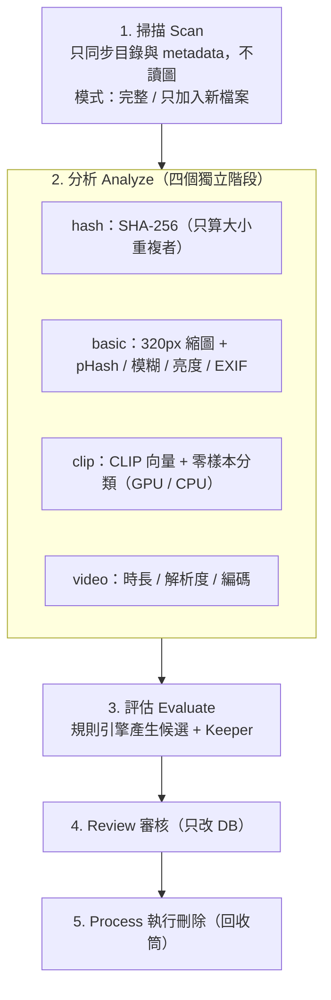

# 相片瘦身 WebApp (Photo Cleaner)

[繁體中文](#zh-tw) | [English](#en)

---

<a id="zh-tw"></a>
## 🇹🇼 繁體中文

本地運行的相片庫整理工具，針對大型相片庫（約 10 萬張、300GB，可放在 NAS）設計。
以 SHA-256、pHash、清晰度 / 亮度與 **CLIP 零樣本分類**找出完全重複、近似重複、模糊、曝光不良、螢幕截圖、文件 / 收據、梗圖與誤拍相片；在虛擬化網格中人工審核後，批次移至 Windows 資源回收筒。

完整規格請見 [`photo-cleaner-functional-spec-0.4.md`](photo-cleaner-functional-spec-0.4.md)。

### 🛡️ 核心防護原則
1. **只有 Process 頁能動實體檔案**：Review 頁的所有操作只改資料庫狀態。
2. **預設移至資源回收筒**（`send2trash`）。
3. **Keeper 保護**：重複群組加入待刪時，系統會保留建議的最佳一張（實作限制見規格書 G-4）。
4. **配對檔案視為同一資產**：Live Photo（HEIC/JPG + MOV）與 RAW + JPG 一起處理。
5. **完全本地**：後端只綁定 `127.0.0.1`，無遙測。

### 🔄 處理流程
掃描、分析、評估三段各自獨立，可單獨執行，也可在 Library 頁依序執行。



#### 💡 NAS 上的 I/O
- **basic** 階段會讀取原檔兩次：一次產生縮圖，一次計算特徵（RAW 使用內嵌預覽）。這一段會產生網路 I/O。
- **clip** 階段優先讀取本地縮圖快取（`thumbs_cache/`）。basic 已完成時，clip 不需再讀取 NAS 原檔。

### 🧠 AI（CLIP）
- open_clip，預設 `ViT-B-16` / `openai`，512 維向量。
- 以 prompt ensemble 對五個類別評分：`normal_photo`、`screenshot`、`document`、`meme`、`mistouch`。該類分數需高於門檻**且**高於 `normal_photo` 才列為候選。
- 已實機驗證：**GTX 1650 Ti**、**RTX 5080**；無 GPU 時以 CPU 執行。
- 分析時可選「自動 / 只用 GPU / 只用 CPU」。選「只用 GPU」但 CUDA 不可用時，工作直接失敗。
- 更換模型後，舊向量標為「過期」，評估時不使用，重跑 clip 階段即可更新。

### 🛠️ 技術架構
- **後端**：Python 3.10+、FastAPI、Uvicorn、SQLAlchemy 2.0、aiosqlite、SQLite（WAL）
- **AI**：PyTorch、torchvision、open-clip-torch
- **影像**：Pillow、pillow-heif、rawpy、OpenCV（headless）、imagehash
- **前端**：React 18、TypeScript、Vite 5、Tailwind CSS、TanStack Virtual、React Router

### ⚙️ 設定
**環境變數（`.env`，從啟動目錄讀取，一般為 `backend/.env`；定義於 `app/core/config.py`）**

| 變數 | 預設值 | 說明 |
|---|---|---|
| `HOST` / `PORT` | `127.0.0.1` / `8000` | 僅供 `/api/health` 回報；實際綁定以 uvicorn 參數為準 |
| `DEBUG` | `false` | SQLAlchemy echo |
| `DATA_DIR` | `backend/data` | 資料目錄 |
| `THUMBS_CACHE_DIR` | `backend/thumbs_cache` | 縮圖快取，建議放 SSD |
| `DATABASE_URL` / `SYNC_DATABASE_URL` | `sqlite(+aiosqlite):///backend/data/app.db` | 要搬移資料庫時須同時修改這兩個；遷移前備份會依此路徑 |
| `SQLITE_BUSY_TIMEOUT_MS` | `30000` | 多執行緒寫入時等待鎖的時間 |
| `HASH_RUNNERS` / `BASIC_RUNNERS` / `CLIP_RUNNERS` / `VIDEO_RUNNERS` | CPU 核心數 // 2（1–16）| 各階段並行數；`CLIP_RUNNERS` 是讀圖執行緒數，GPU 推理固定一條流水線；Settings 頁的值會覆寫 |
| `CLIP_BATCH_SIZE` | `0`（自動）| 0 = 依顯存：≥12GB 128、≥6GB 64、其餘 32；CPU 16。顯存不足時自動減半 |

**執行時設定（Settings 頁，存於 SQLite `settings` 表）**：
- 規則開關與門檻
- CLIP 模型（`clip_model` / `clip_pretrained`）
- 預設運算裝置（`compute_device`）
- 各階段 runner 數（1–16）

| 預設門檻 | 值 |
|---|---|
| 截圖 / 文件 / 梗圖 / 誤拍 | 0.60 / 0.55 / 0.65 / 0.55 |
| 近似重複方式 | `either`（CLIP 或 pHash 任一符合）|
| CLIP 近似門檻 / pHash 漢明距離 | 0.95 / 6 |
| 近似群組上限 | 50（超過自動收緊門檻拆小）|
| 連拍：時間視窗 / CLIP 相似度 | 2 秒 / 0.85 |
| 模糊（Laplacian 變異數）| 100 |
| 過暗 / 過曝（平均亮度）| 30 / 225 |

#### 🚀 效能建議
- 把 `THUMBS_CACHE_DIR` 放在本機 SSD。
- CLIP 為批次推理（loader 執行緒讀縮圖 → GPU 批次 fp16 → 背景批次寫入）。先跑 basic 產生縮圖，clip 階段就不需要再讀 NAS。
- 測速：`python scripts/bench_clip.py <相片資料夾> --limit 2000`
- 調高 runner 前，請確認 SQLAlchemy 連線池（`database.py`）足夠，且 SQLite 同時只允許一個寫入者。

### 🚀 快速啟動
#### 1. 後端
```powershell
cd backend
python -m venv venv
.\venv\Scripts\Activate.ps1
pip install -r requirements.txt
uvicorn app.main:app --host 127.0.0.1 --port 8000
```

#### GPU（選用）
- 介面提供「一鍵啟用 GPU 加速」，可安裝 `cu121` / `cu118` 版 PyTorch。
- **RTX 50 系列（如 RTX 5080）需要 CUDA 12.8 版 wheel**，請手動安裝：
  ```powershell
  pip install torch torchvision --index-url https://download.pytorch.org/whl/cu128
  ```

#### 2. 前端
```powershell
cd frontend
npm install
npm run dev   # http://127.0.0.1:5173，/api 代理至 8000
```

#### 3. 測試
```powershell
cd backend
pytest
```

### 📂 專案結構
```
photo-cleaner/
├── backend/
│   ├── app/
│   │   ├── api/        # roots, jobs, scan(相容), analysis, candidates, process, history,
│   │   │               # settings, thumbnails, dashboard, system
│   │   ├── core/       # config, database (WAL), migration (user_version), progress (SSE)
│   │   ├── models/     # schema.py, enums.py
│   │   ├── services/   # scanner, pairing, scan_job, analyze_job, hash/basic/clip/video_stage,
│   │   │               # feature_pipeline, thumbnail, rules_engine, deletion, stats_service, cuda_manager
│   │   ├── stubs/      # 名稱沿用歷史命名，內容為真實實作：clip_stub (open_clip), raw_stub (rawpy),
│   │   │               # video_probe_stub (OpenCV), vector_stub (餘弦相似度索引)
│   │   └── main.py
│   ├── tests/          # pytest
│   └── requirements.txt
├── frontend/src/
│   ├── pages/          # Dashboard, Library, Review, Process, History, Settings
│   ├── components/     # layout/AppShell, common/(ScanProgressBar, CudaInstallModal),
│   │                   # scan/(ScanPanel, AnalysisPanel, EvaluatePanel)
│   ├── hooks/          # useScanProgress (SSE + 輪詢)
│   └── services/       # api.ts, types.ts
├── photo-cleaner-functional-spec-0.4.md
├── spec-update-scan-analysis.md   # 已併入 v0.4，保留作歷史紀錄
└── AGENT.md
```

---

<a id="en"></a>
## 🇺🇸 English

A local web app for cleaning up large photo libraries (about 100k photos / 300GB, local disk or NAS).
It uses SHA-256, pHash, sharpness/brightness metrics and **CLIP zero-shot classification** to find exact duplicates, near duplicates, blurry or badly exposed shots, screenshots, documents/receipts, memes and accidental shots. You review them in a virtualized grid, then batch-move them to the Windows Recycle Bin.

See [`photo-cleaner-functional-spec-0.4.md`](photo-cleaner-functional-spec-0.4.md) for the full specification (Traditional Chinese).

### 🛡️ Core Safety Rules
1. **Only the Process page touches files.** The Review page changes database state only.
2. **Recycle Bin by default** (`send2trash`).
3. **Keeper protection.** When a duplicate group is queued, the suggested best copy is kept (see spec gap G-4 for current limits).
4. **Paired files are one asset.** Live Photo (HEIC/JPG + MOV) and RAW + JPG are always handled together.
5. **Fully local.** The backend binds to `127.0.0.1` only, with no telemetry.

### 🔄 Workflow
Scan, Analyze and Evaluate are independent jobs:
1. **Scan** syncs files and metadata without reading image content. Modes: `full` or `new_only`.
2. **Analyze** runs four independent stages:
   - `hash`: SHA-256, only for files whose size is duplicated
   - `basic`: 320px thumbnail, pHash, blur, brightness and EXIF
   - `clip`: CLIP embedding and zero-shot scores, on GPU or CPU
   - `video`: duration, resolution and codec
3. **Evaluate** runs the rules engine to build candidates and pick keepers.
4. **Review** your candidates.
5. **Process** the queued ones to delete them.

**NAS I/O.**
- `basic` reads each original file twice: once for the thumbnail and once for features.
- `clip` reads the local thumbnail cache first, so it does not re-read originals from the NAS once `basic` is done.

### 🧠 AI (CLIP)
- Uses open_clip, default `ViT-B-16` / `openai`, with 512-dim embeddings.
- Prompt-ensemble zero-shot classification over five classes: `normal_photo`, `screenshot`, `document`, `meme` and `mistouch`. A photo becomes a candidate only if a class score passes its threshold **and** beats `normal_photo`.
- Verified on **GTX 1650 Ti** and **RTX 5080**; falls back to CPU when no GPU is available.
- You choose the device per run (auto / GPU only / CPU only). GPU-only fails fast if CUDA is unavailable.
- After a model change, old vectors are marked stale, excluded from evaluation and recomputed by the next `clip` run.

### 🛠️ Tech Stack
- **Backend:** FastAPI, SQLAlchemy 2.0, SQLite (WAL)
- **AI:** PyTorch, open-clip-torch
- **Imaging:** Pillow, pillow-heif, rawpy, OpenCV, imagehash
- **Frontend:** React 18, TypeScript, Vite 5, Tailwind CSS, TanStack Virtual

### ⚙️ Configuration
- **Environment (`.env` in the working directory, normally `backend/.env`; defined in `app/core/config.py`):**
  - `HOST` / `PORT` (`127.0.0.1` / `8000`): reported by `/api/health` only; the actual bind comes from the uvicorn arguments.
  - `DEBUG` (`false`)
  - `THUMBS_CACHE_DIR` (`backend/thumbs_cache`)
  - `DATA_DIR` (`backend/data`). The database location comes from `DATABASE_URL` / `SYNC_DATABASE_URL` (default `backend/data/app.db`), so change both if you move it; the pre-migration backup follows that path.
  - `HASH_RUNNERS` / `BASIC_RUNNERS` / `CLIP_RUNNERS` / `VIDEO_RUNNERS`: default CPU cores // 2 (1–16). `CLIP_RUNNERS` is the number of image-loader threads; GPU inference is always one pipeline. Settings-page values override them.
  - `CLIP_BATCH_SIZE` (`0` = automatic by VRAM) and `SQLITE_BUSY_TIMEOUT_MS` (`30000`).
  - All rule thresholds live in `app/core/defaults.py` and are changed on the Settings page.
- **Runtime settings (Settings page, stored in SQLite):** rule toggles and thresholds, CLIP model, default device and per-stage runners (1–16).
- **Default thresholds:**
  - Screenshot / document / meme / mistouch: 0.60 / 0.55 / 0.65 / 0.55
  - pHash distance: 6
  - Blur: 100
  - Under / over exposure: 30 / 225
- **Performance:**
  - Keep `THUMBS_CACHE_DIR` on a local SSD.
  - The CLIP runner is forced to 1 on CUDA.
  - CLIP runs in batches (loader threads → fp16 GPU batches → bulk DB writes); batch size is automatic and halves on out-of-memory.
  - Benchmark: `python scripts/bench_clip.py <photo folder> --limit 2000`.

### 🚀 Getting Started
```powershell
# Backend
cd backend; python -m venv venv; .\venv\Scripts\Activate.ps1
pip install -r requirements.txt
uvicorn app.main:app --host 127.0.0.1 --port 8000

# RTX 50-series GPUs need the CUDA 12.8 wheel (the in-app installer offers cu121/cu118 only)
pip install torch torchvision --index-url https://download.pytorch.org/whl/cu128

# Frontend
cd frontend; npm install; npm run dev   # http://127.0.0.1:5173

# Tests
cd backend; pytest
```
