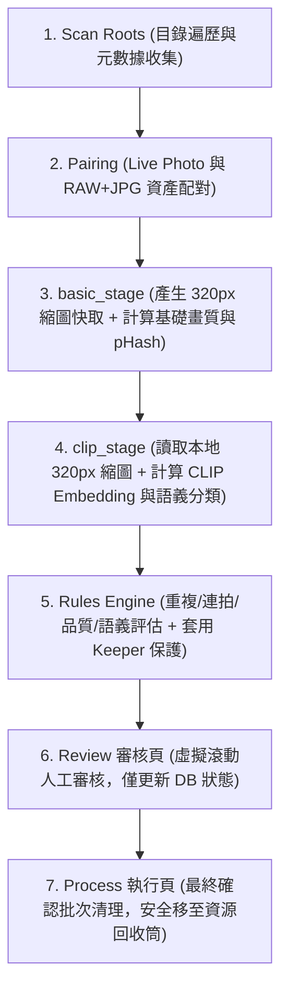
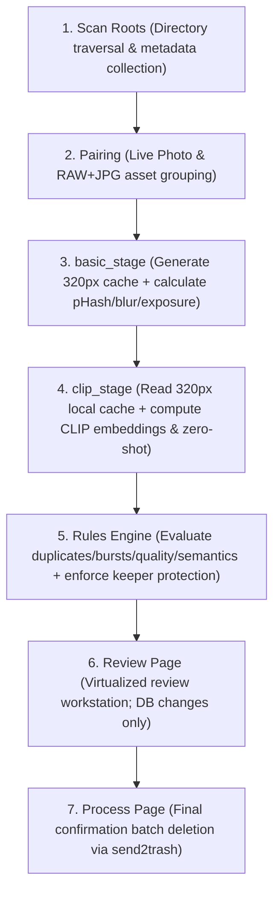

# 相片瘦身 WebApp (Photo Cleaner)

[繁體中文](#zh-tw) | [English](#en)

---

<a id="zh-tw"></a>
## 🇹🇼 繁體中文

本地運行的相片庫整理與瘦身工具。專為龐大相片庫（如 10 萬張以上、300GB+、NAS 儲存）設計，透過多階段管線、AI 深度語義特徵（CLIP）與規則引擎，精準找出相片庫中的完全重複、近似重複、連拍多餘、螢幕截圖、單據文件、表情包梗圖、模糊與曝光不良等廢片。前端提供流暢的虛擬滾動工作台供人工審核，並以嚴格的資源回收筒機制執行批量安全清理。

---

### 🛡️ 核心防護原則（鐵則）

1. **只有 Process 頁能動實體檔案**：Review 審核頁面的所有挑選、忽略、標記操作僅變更資料庫狀態，絕不觸碰實體硬碟檔案。
2. **預設安全刪除**：使用作業系統資源回收筒（Windows `send2trash`），刪除後可隨時於桌面資源回收筒還原。
3. **保留最後一張保護（Keeper Protection）**：任何重複或連拍分組中，系統強制防呆機制，禁止全選刪除，確保每個分組至少保留一份最佳檔案。
4. **配對檔案一併處置**：Live Photo（HEIC/JPG + MOV）與 RAW + JPG 自動綁定為單一資產（Asset），刪除與保留操作絕對連動，不拆散檔案。
5. **資料全程不離開本機**：服務僅監聽 `127.0.0.1`，完全無外部網路連線與雲端遙測。

---

### 🔄 處理管線 (Processing Pipeline)

系統採用多階段解耦管線設計，確保即使相片儲存於遠端 NAS，也能達到極致的分析效能與最低的網路負載：



#### 💡 為什麼 clip 階段「網路傳輸 Network I/O = 0」？
- 在 `basic_stage` 中，系統已預先自原始檔案（含龐大的 RAW / 4K 相片）解碼，並將高畫質 320px 縮圖快取儲存於本機高速儲存裝置（`thumbs_cache/`）。
- CLIP 模型（如 ViT-B-16）的標準輸入維度僅為 224x224。因此在進入 `clip_stage` 時，推理引擎直接讀取本地已存在的 320px 縮圖，**完全不需要再次經由網路/SMB 讀取遠端 NAS 上的原始檔案**。
- 這消除了 NAS 隨機讀取與網路頻寬瓶頸，使 CLIP 語義分析速度提升數倍，並確保網路監控流量在此階段維持為 0。

---

### 🛠️ 技術架構

- **後端 (Backend)**：
  - Python 3.10+、FastAPI、Uvicorn
  - SQLAlchemy 2.0、aiosqlite、SQLite（WAL 模式併發）
  - **AI / 深度學習**：PyTorch (`torch`, `torchvision`)、`open-clip-torch` (CLIP ViT-B-16 / 零樣本分類)、Cosine 相似度矩陣
  - **影像處理**：Pillow、pillow-heif (HEIC 支援)、rawpy (RAW 相機原生解碼)、OpenCV (模糊與曝光檢測)、imagehash (pHash)
  - **安全與系統**：`send2trash` (Windows 資源回收筒整合)、Server-Sent Events (SSE 即時進度廣播)
- **前端 (Frontend)**：
  - React 18、Vite、TypeScript
  - Tailwind CSS、Lucide React
  - TanStack Virtual (高效能大型相片縮圖虛擬滾動)

---

### ⚙️ 配置與效能調優

所有進階選項皆可透過專案目錄下的 `.env` 檔案或後端設定調整：

```env
# 服務監聽
HOST=127.0.0.1
PORT=8000

# 存儲目錄
DATA_DIR=backend/data
THUMBS_CACHE_DIR=backend/thumbs_cache

# 運算裝置與模型
DEVICE=auto             # auto: 優先使用 CUDA，無則自動降級 CPU | cuda: 強制 GPU | cpu: 純 CPU
CLIP_BATCH_SIZE=32      # CLIP 推理批次大小 (加大可提高 GPU 使用率)

# 並行 Worker (Runners)
BASIC_RUNNERS=8         # 基礎特徵與縮圖 Worker 數 (預設為 CPU 核心數 // 2)
CLIP_RUNNERS=1          # CLIP Worker 數 (CUDA 模式下強制為 1)
HASH_RUNNERS=4          # 雜湊計算 Worker 數
VIDEO_RUNNERS=2         # 影片檢查 Worker 數
```

#### 🚀 效能調優關鍵指南：

1. **縮圖快取放置於 NVMe SSD**：
   - 強烈建議將 `THUMBS_CACHE_DIR` 設在本地高速 NVMe SSD 上。百萬次的高速 IOPS 讀取能徹底消除縮圖快取 I/O 延遲，並讓前端虛擬滾動流暢不卡頓。
2. **SQLite 連線池限制 (QueuePool Limit)**：
   - SQLAlchemy 預設的連線池為 `pool_size=5, max_overflow=10`（最大 15 個同時連線）。
   - 若將 `BASIC_RUNNERS` 或其他階段的 runners 開大超過連線池上限，多執行緒同時請求 DB 連線時會觸發 `QueuePool limit exceeded` 報錯。若需增加大量 runners，請務必在 `database.py` 中相應加大 `pool_size` 與 `max_overflow`。
3. **CUDA 模式下 runners 強制為 1**：
   - 當 `DEVICE` 設為 `cuda` 時，系統會自動將 `CLIP_RUNNERS` 強制設為 `1`。因為多個執行緒同時競爭同一 GPU CUDA context 會造成顯存碎裂與嚴重鎖競爭，單一流水線是最穩定的作法。提速的正確方式是提高 `CLIP_BATCH_SIZE`。
4. **「CPU 100% 但 GPU 僅 20%」是單張推理的正常現象**：
   - CLIP 特徵提取包含兩個步驟：① CPU 端影像載入與預處理（Transform/Resize/Normalize）、② GPU 端神經網路 Forward Pass。
   - 單張推理時，GPU 僅需數毫秒即可算完，大量時間消耗在 CPU 端的解碼與搬移。配合本地縮圖快取並調大 batch size，可顯著改善吞吐量。

---

### 🚀 快速啟動

#### 1. 後端 (Backend)

```bash
cd backend

# 建立並啟用虛擬環境 (Windows PowerShell)
python -m venv venv
.\venv\Scripts\Activate.ps1

# 安裝依賴套件
pip install -r requirements.txt

# 啟動 FastAPI 服務 (監聽 127.0.0.1:8000)
uvicorn app.main:app --host 127.0.0.1 --port 8000 --reload
```

> **提示**：系統具備 NVIDIA GPU 自動檢測。若環境具備相容的 NVIDIA 顯卡，可於系統設定中一鍵升級安裝 CUDA 版 PyTorch。

#### 2. 前端 (Frontend)

```bash
cd frontend

# 安裝依賴套件
npm install

# 啟動開發伺服器 (http://127.0.0.1:5173，API 自動 Proxy 至 8000)
npm run dev
```

---

### 📂 專案結構

```
photo-cleaner/
├── backend/                  # FastAPI 後端
│   ├── app/
│   │   ├── api/              # RESTful API 路由 (roots, scan, analyze, settings, thumbnails)
│   │   ├── core/             # 資料庫 WAL 連線、配置 (.env) 與版本遷移
│   │   ├── models/           # SQLAlchemy 關聯資料模型與列舉定義
│   │   ├── services/         # 核心邏輯：scanner, pairing, basic_stage, clip_stage, rules_engine, deletion
│   │   └── stubs/            # 影像分析與特徵抽取底層 (clip_stub, vector_stub)
│   ├── data/                 # SQLite 資料庫 (app.db) 預設存放路徑
│   ├── thumbs_cache/         # 320px 本地高速縮圖快取目錄
│   └── requirements.txt      # 後端 Python 依賴清單
├── frontend/                 # React + Vite 前端
│   ├── src/
│   │   ├── components/       # 側邊欄導航、進度條 (ScanProgressBar) 與通用 UI 元件
│   │   └── pages/            # 核心頁面 (Dashboard, Library, Review, Process, Settings, History)
│   └── package.json          # 前端依賴清單
├── photo-cleaner-functional-spec-0.3.md # 完整功能規格書
└── AGENT.md                  # 核心開發準則與防護鐵則
```

---

<a id="en"></a>
## 🇺🇸 English

A locally hosted web application for photo library organization, deduplication, and cleanup. Tailored for handling massive personal photo libraries (100k+ photos, 300GB+, NAS storage). Powered by a multi-stage analysis pipeline, AI semantic embeddings (CLIP), and a multi-factor rules engine, Photo Cleaner reliably identifies exact duplicates, near duplicates, burst shots, screenshots, receipts/documents, memes, blurry photos, and bad exposures. It features a virtualized grid for manual review and safe batch deletion via the OS Recycle Bin.

---

### 🛡️ Core Safety Principles (Non-Negotiable Rules)

1. **Physical Files Are Only Touched on the Process Page**: All actions on the Review page (selecting, ignoring, modifying status) strictly modify the local database state. Physical storage is never touched during review.
2. **Default Safe Deletion**: Deletion targets the OS Recycle Bin via Windows `send2trash`. Files can be restored directly from the desktop Recycle Bin if needed.
3. **Keeper Protection (Never Delete All)**：The rules engine strictly enforces keeper protection across duplicate and burst groups. It is impossible to select all photos in a group for deletion—at least one best asset is guaranteed to be retained.
4. **Paired Files Managed Together**: Live Photos (HEIC/JPG + MOV) and RAW + JPG pairs are automatically treated as a single compound Asset. Retention and deletion operations affect all paired components together.
5. **100% Local Processing**: Binds strictly to `127.0.0.1`. No telemetry, no external network requests, and zero cloud uploads.

---

### 🔄 Processing Pipeline

Designed with a decoupled, staged architecture to maximize throughput and minimize network load over NAS/SMB connections:



#### 💡 Why Network I/O is ZERO during the CLIP Stage
- In `basic_stage`, high-resolution original images and heavy RAW files are decoded once to produce 320px thumbnail caches on the local drive (`thumbs_cache/`).
- Standard CLIP vision backbones (e.g., ViT-B-16) accept 224x224 input tensors. Therefore, during `clip_stage`, the inference engine reads directly from the local 320px thumbnail cache, **never re-fetching original photos over SMB from the NAS**.
- This completely eliminates random seek latency over the network and brings network transmission to exactly zero during semantic extraction.

---

### 🛠️ Tech Stack

- **Backend**:
  - Python 3.10+, FastAPI, Uvicorn
  - SQLAlchemy 2.0, aiosqlite, SQLite (WAL mode)
  - **AI / Deep Learning**: PyTorch (`torch`, `torchvision`), `open-clip-torch` (ViT-B-16 / Zero-shot classification), Cosine Similarity matrix calculation
  - **Image Processing**: Pillow, pillow-heif (HEIC support), rawpy (native camera RAW decoding), OpenCV (blur & exposure analysis), imagehash (pHash)
  - **System & Safety**: `send2trash` (Windows Recycle Bin integration), Server-Sent Events (SSE real-time progress broadcast)
- **Frontend**:
  - React 18, Vite, TypeScript
  - Tailwind CSS, Lucide React
  - TanStack Virtual (high-performance virtualized grid for massive image collections)

---

### ⚙️ Configuration & Performance Tuning

Configure runtime options via `.env` in the root or backend directory:

```env
# Server
HOST=127.0.0.1
PORT=8000

# Storage Directories
DATA_DIR=backend/data
THUMBS_CACHE_DIR=backend/thumbs_cache

# Compute Device & AI
DEVICE=auto             # auto: Prefer CUDA if available, fallback to CPU | cuda: Force GPU | cpu: Force CPU
CLIP_BATCH_SIZE=32      # Batch size for CLIP inference

# Concurrency Runners
BASIC_RUNNERS=8         # Workers for basic stage (default: CPU cores // 2)
CLIP_RUNNERS=1          # Workers for CLIP stage (enforced to 1 under CUDA)
HASH_RUNNERS=4          # Workers for hash stage
VIDEO_RUNNERS=2         # Workers for video check stage
```

#### 🚀 Key Performance Insights:

1. **Place Thumbnail Cache on NVMe SSD**:
   - Set `THUMBS_CACHE_DIR` to a fast local NVMe SSD. High random-read IOPS eliminates I/O bottlenecks during both AI inference and frontend virtual scrolling.
2. **SQLite QueuePool Limits**:
   - SQLAlchemy engines default to `pool_size=5, max_overflow=10` (max 15 concurrent connections).
   - If `BASIC_RUNNERS` or other worker counts are increased beyond the connection limit, workers will encounter `QueuePool limit of size 5 overflow 10 reached`. Increase `pool_size` and `max_overflow` in `database.py` accordingly when scaling up runners.
3. **CLIP Runners Locked to 1 on CUDA**:
   - When `DEVICE=cuda`, `CLIP_RUNNERS` is locked to `1` by design. Multiple worker threads competing for the same CUDA context induce driver overhead and memory fragmentation. Increasing `CLIP_BATCH_SIZE` is the proper way to maximize GPU throughput.
4. **CPU 100% & GPU 20% Utilization is Normal**:
   - Single-image inference pipelines spend significant time on CPU-bound image decompression, tensor transformations, and normalization, while the GPU forward pass takes only a few milliseconds. Batched processing and local NVMe caching help balance utilization.

---

### 🚀 Getting Started

#### 1. Backend

```bash
cd backend

# Create & activate virtual environment (Windows PowerShell)
python -m venv venv
.\venv\Scripts\Activate.ps1

# Install dependencies
pip install -r requirements.txt

# Start FastAPI server (Listening on 127.0.0.1:8000)
uvicorn app.main:app --host 127.0.0.1 --port 8000 --reload
```

> **Note**: Includes automatic NVIDIA hardware detection. If a supported NVIDIA GPU is detected, you can enable PyTorch CUDA with one click in the Settings UI.

#### 2. Frontend

```bash
cd frontend

# Install Node dependencies
npm install

# Launch Vite dev server (http://127.0.0.1:5173, proxies /api to 8000)
npm run dev
```

---

### 📂 Directory Structure

```
photo-cleaner/
├── backend/                  # FastAPI Backend
│   ├── app/
│   │   ├── api/              # RESTful API routes (roots, scan, analyze, settings, thumbnails)
│   │   ├── core/             # Database WAL engine, configuration (.env), and migrations
│   │   ├── models/           # SQLAlchemy database schemas and enums
│   │   ├── services/         # Business logic: scanner, pairing, basic_stage, clip_stage, rules_engine, deletion
│   │   └── stubs/            # Low-level feature extractors (clip_stub, vector_stub)
│   ├── data/                 # SQLite database (app.db) storage
│   ├── thumbs_cache/         # 320px local high-speed thumbnail cache
│   └── requirements.txt      # Python dependencies
├── frontend/                 # React + Vite Frontend
│   ├── src/
│   │   ├── components/       # Navigation sidebar, ScanProgressBar, shared UI components
│   │   └── pages/            # Core views (Dashboard, Library, Review, Process, Settings, History)
│   └── package.json          # Node dependencies
├── photo-cleaner-functional-spec-0.3.md # Comprehensive functional specification
└── AGENT.md                  # Development guidelines and core principles
```
