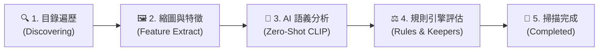
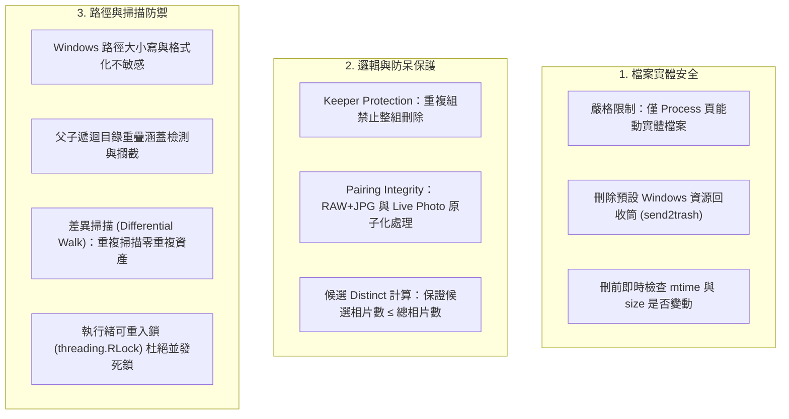

# 相片瘦身 WebApp：Functional Spec（v0.3.1）

> **版本更新紀錄**：
> - **v0.3.1 (當前版本)**：
>   1. **強化 AI 語義內容分類為核心第一優先級**：獨立將「螢幕截圖 (Screenshots)」、「文件/發票/收據 (Documents & Receipts)」、「梗圖/迷因/表情包 (Memes)」、「誤拍/口袋黑畫面 (Mistouches)」提升為一級 AI 核心分析與審核分類。
>   2. **全面消除黑盒：即時透明掃描進度條（ScanProgressBar）**：採用 Server-Sent Events (SSE) + 智慧輪詢雙通道，提供五階段進度導軌、實時處理相片路徑、每秒處理速度（fps）、預估剩餘時間（ETA）、不重複待清理資產計數與隨時中斷掃描功能。
>   3. **獨立設定管理頁面（Settings）**：完整支援各項 AI 語義信心度門檻、重複與品質門檻、保留者（Keeper）策略之動態調整，並提供免重新掃描的一鍵「重新評估規則」與「恢復預設值」。
>   4. **路徑衝突與並發防禦**：Windows 大小寫不敏感標準化、父子遞迴目錄重疊涵蓋檢測、重複掃描差異跳過（冪等性保證）與可重入鎖（`threading.RLock`）並發保護。
> - **v0.3**：開發階段改為第一階段即包含 AI 篩選。
> - **v0.2**：納入決策：回收筒為預設刪除模式、完整支援 RAW、影片只做大小檢查、跨路徑重複要處理、介面只有繁體中文。

---

## 1. 目標與範圍

**目標**：本地運行的網頁工具，掃描指定資料夾，用 AI 語義分析與規則引擎精準識別**截圖、文件、梗圖、誤拍、重複、近似與質量廢片**，讓使用者以虛擬化縮圖網格批量審核，安全且一次性地真實刪除（移至資源回收筒），或進行排除與還原。

**核心特色**：
- **AI 內容深度語義分析**：利用 GPU / CLIP 零樣本分類，一眼挑出佔空間的螢幕截圖、發票單據、網路表情包與口袋誤拍黑畫面。
- **全透明即時掃描**：清晰展示處理階段、實時檔案路徑、處理速率與剩餘時間，告別黑盒等待。
- **鐵則級資料保護**：僅 Process 頁能動實體檔案、預設資源回收筒（`send2trash`）、保留最後一張防呆保護、配對檔案（RAW+JPG / Live Photo）不可分割。

**非目標（v1 不做）**：雲端同步、多用戶、手機 App、相片編輯、人臉辨識、語義搜尋、影片內容解碼分析、多語言介面。

**使用情境**：單一用戶，Windows 筆電（Ultra 9、32GB RAM、RTX 5080 / CPU 測試模式），約 10 萬張、300GB，資料全程不離開本機。

---

## 2. 已確認的架構決策

| # | 議題 | 決定與規格 |
|---|---|---|
| 1 | 刪除預設模式 | **資源回收筒**（使用 `send2trash`；另提供隔離資料夾、永久刪除兩個選項） |
| 2 | RAW 檔支援 | **完整支援**（解碼、分析、縮圖、與 JPG 配對），統一在縮圖尺寸做特徵提取 |
| 3 | 影片處理 | **不做內容分析**，僅以容器元數據進行大小檢查（完全相同大小、過小影片） |
| 4 | 多路徑重複 | **完整支援**（跨路徑比對，可自訂路徑優先順序） |
| 5 | AI 語義識別 | **一級核心功能**（螢幕截圖、文件/發票、梗圖/表情包、口袋誤拍） |
| 6 | 掃描可視化 | **即時透明進度條**（SSE 廣播、即時當前處理檔案路徑、速度 fps、ETA、中斷控制） |
| 7 | 介面語言 | **嚴格繁體中文（zh-TW）**，服務僅綁定 `127.0.0.1` |

---

## 3. 核心概念：候選狀態機

每個資產（Asset）在系統中有明確的狀態生命週期：

```
未分析(unanalysed) → 已分析(analysed) → 候選(candidate) ─┬→ 待刪(queued) → 已刪除(deleted)
                                             │           └→ 移出待刪 → 候選/已排除
                                             └→ 已排除(kept)，之後重新評估亦優先保護
```

- **候選 (Candidate)**：系統根據 AI 語義分析或規則引擎建議清理，等待使用者決定。
- **已排除 (Kept)**：使用者明確標記保留，重新掃描或重評規則時不會被列入刪除建議。
- **待刪 (Queued)**：使用者在 Review 頁面確認勾選待清理，等待在 Process 頁面最終批次執行。
- **已刪除 (Deleted)**：已在 Process 頁面執行刪除，保留操作軌跡與記錄。
- **資產 (Asset)**：一個或多個檔案的組合，視為單一處理單位。例如 Live Photo（HEIC + MOV）、RAW + JPG 配對，處理時不可分割。

---

## 4. 功能模組詳細規格

### 4.1 Library（資料庫掃描與路徑管理）

#### 4.1.1 目錄管理與路徑防護
- **新增／移除目錄**：輸入本機絕對路徑（例如 `D:\Photos\2023`），支援設定遞迴掃描與排除 patterns。
- **Windows 路徑不敏感標準化**：自動呼叫 `Path.resolve()`，`c:\photos` 與 `C:\Photos` 視為同一路徑。
- **路徑涵蓋與重疊衝突防護**：
  - 若已登錄父目錄 `D:\Photos`（遞迴），使用者嘗試新增 `D:\Photos\2023` 時，系統主動攔截並提示：「已由上層遞迴目錄涵蓋，無需重複加入」。
  - 若已登錄子目錄 `D:\Photos\2023`，使用者嘗試新增父目錄 `D:\Photos` 時，系統提示請先移除子目錄以避免重複遍歷。
- **路徑優先順序**：清單順序代表重複組的保留優先權（排在越上方的目錄優先保留）。

#### 4.1.2 全透明即時掃描進度條（ScanProgressBar）
徹底消除傳統掃描的「黑盒」感，提供極致透明的視覺化監控：



- **五階段可視化導軌**：清晰標記當前執行進度。
- **即時遙測數據 (Real-time Telemetry)**：
  - **當前處理檔案**：以等寬字體動態顯示目前後端正在處理的照片檔案（例如：`D:/Photos/.../IMG_0245.JPG`）。
  - **即時處理速度**：即時換算 `X 張/秒`（fps）。
  - **預估剩餘時間 (ETA)**：根據動態速率預估剩餘秒數（`剩餘約 X 分 Y 秒`）。
  - **進度百分比與計數**：顯示 `245 / 493 檔案 (49.7%)`。
  - **差異掃描統計**：精確呈現 `新登錄相片庫資產：+N 筆`。
  - **不重複候選數**：計算 Distinct 候選資產總數（$\le$ 總資產數）。
- **互動控制**：
  - **中斷掃描**：隨時點擊「中斷掃描」，後端安全中止迴圈。
  - **一鍵跳轉**：掃描完成後，卡片自動顯示「前往審核工作台 👉」按鈕。
- **雙通道通訊架構**：後端採用 Server-Sent Events (`/api/scan/events`)，前端在網路或瀏覽器休眠時自動無縫 fallback 至高頻輪詢 (`/api/scan/status`)。

---

### 4.2 RAW 與配對完整性支援

| 面向 | 做法 |
|---|---|
| 解碼 | 使用 `rawpy`（LibRaw），失敗時優雅降級為內嵌預覽圖 |
| 縮圖快取 | 優先提取內嵌 JPEG 生成 320px WebP 快取 |
| 分析尺標 | 統一在縮圖尺寸計算模糊、亮度與 CLIP 向量，避免全尺寸解碼耗盡 GPU/CPU |
| Live Photo | 同檔名之 `HEIC/JPG + MOV`（時長 $\le 5$ 秒）自動綁定為同一資產 |
| RAW + JPG | 同檔名之 `RAW + JPG` 自動綁定為同一資產，UI 標示「含 RAW」 |
| 保留與刪除 | 配對檔案必須**同生共死**，加入待刪或刪除時將所有配對檔案原子化處理 |

---

### 4.3 AI 分析與特徵管線（Analysis Pipeline）

每張相片只在首次發現時分析一次，所有特徵寫入 SQLite WAL 資料庫：

| 特徵項目 | 實作方式與目的 |
|---|---|
| **檔案雜湊 (SHA-256)** | 先過濾相同檔案大小，再計算 Hash，秒級找出完全重複檔案 |
| **感知雜湊 (pHash)** | 64-bit DCT 感知雜湊，用以快速比對構圖近似圖 |
| **模糊分數 (Blur Score)** | 縮圖之 Laplacian Variance 分數，判斷手震、失焦 |
| **亮度／曝光 (Brightness)** | 灰階直方圖平均亮度，過暗（$<30$）或過曝（$>225$）檢查 |
| **CLIP 語義嵌入向量** | open_clip / SigLIP 512 維特徵向量（存為 BLOB / FAISS 索引） |
| **AI 零樣本語義分類 (Zero-Shot)** | 針對 4 大核心垃圾相片類別進行多標籤信心度評分（0.0 ~ 1.0） |
| **EXIF 拍攝資訊** | 拍攝時間（`taken_at`）、相機型號、鏡頭、解析度 |
| **縮圖快取** | 320px 高畫質縮圖快取（`thumbs_cache/`），供虛擬捲動即時載入 |

---

### 4.4 偵測規則引擎（Detection Rules）

所有規則可於「設定頁面」中獨立調整門檻與開關。規則評估僅運算資料庫特徵，調整後可**秒級重新評估**，無需重新掃描實體相片。

#### 4.4.1 AI 內容語義規則（第一優先核心）

| 規則項目 | 識別對象 | 預設門檻 | 預設狀態 |
|---|---|---|---|
| 📱 **螢幕截圖 (Screenshot)** | 手機/電腦螢幕截圖、對話紀錄截圖 | 信心度 $\ge 0.70$ | **開啟** |
| 📄 **文件 / 發票 / 收據 (Document)** | 紙本文件、發票、收據、白板筆記、菜單 | 信心度 $\ge 0.65$ | **開啟** |
| 🎭 **梗圖 / 迷因 (Meme)** | 網路迷因、表情包、帶大字圖片 | 信心度 $\ge 0.75$ | **開啟** |
| 🌑 **誤拍 / 廢片 (Mistouch)** | 口袋誤觸黑畫面、純地板/天花板、手指遮鏡頭 | 信心度 $\ge 0.60$ | **開啟** |

#### 4.4.2 重複與質量缺陷規則

| 規則項目 | 說明 | 預設門檻 | 預設狀態 |
|---|---|---|---|
| **完全重複 (Exact Dup)** | SHA-256 完全相同（含跨路徑） | 100% 匹配 | **開啟** |
| **近似重複 (Near Dup)** | pHash 漢明距離（Hamming Distance） | 距離 $\le 6$ | **開啟** |
| **連拍多餘 (Burst)** | 時間差 $\le 2$ 秒 且 CLIP 相似度 $\ge 0.85$ | 組內保留最佳張 | **開啟** |
| **相片模糊 (Blur)** | Laplacian Variance 分數過低 | 分數 $< 100.0$ | **開啟** |
| **曝光異常 (Exposure)** | 過暗或過曝 | 亮度 $< 30$ 或 $> 225$ | **開啟** |
| **影片大小重複 (Video Size)** | 檔案大小相同且 SHA-256 完全相同 | 相同大小預篩 | **開啟** |
| **極小影片 (Tiny Video)** | 檔案大小過小 | 檔案 $< 100$ KB | 關閉 |

#### 4.4.3 最佳保留者守護（Keeper Protection）
- **重複組守護鐵則**：任何完全重複或近似重複群組，系統會根據設定優先順序自動挑選一張「最佳保留者（Keeper）」並標註綠框。
- **防呆保護（不可整組刪除）**：若使用者嘗試將整組（包含 Keeper）全部加入待刪清單，規則引擎會自動攔截並強制保留最佳版本，杜絕誤刪事故。

---

### 4.5 Review 頁（審核工作台）

**目的**：以高流暢虛擬化縮圖網格，讓使用者依類別快速確認要刪除或保留的相片。

- **頂部類別篩選頁籤**：
  - 🌟 **全部候選**
  - 📱 **螢幕截圖**
  - 📄 **文件與收據**
  - 🎭 **梗圖與迷因**
  - 🌑 **誤拍廢片**
  - 👥 **重複與近似**
  - 🌫️ **模糊與曝光**
- **操作與互動**：
  - 單擊選取、Shift 連續範圍選取、Ctrl 多選、全選當前篩選、反選。
  - 雙擊開啟大圖預覽，顯示 EXIF、路徑、檔案大小、AI 命中原因與分數。
  - 鍵盤快捷鍵：`D` 標記為待刪（Queued）、`K` 標記為保留（Kept）、`Esc` 關閉預覽。
- **重複組並排檢視**：
  - 重複組以分組卡片並排呈現，Keeper 以綠色標記，其餘以紅色標記。
  - 可一鍵切換組內其他照片為保留者。

---

### 4.6 Process 頁（執行刪除）

**鐵則：本頁面為全系統「唯一定義並執行檔案物理刪除」的入口。**

- **防呆確認機制**：
  - 集中呈現待刪清單總覽：張數、預計釋放容量、依分類與目錄分佈。
  - 刪除前二次確認彈窗，要求使用者明確確認。
- **刪除模式**：
  1. **資源回收筒（預設）**：透過 `send2trash` 移至 Windows 資源回收筒，安全可救回。
  2. **隔離資料夾**：搬移至 `_quarantine/` 目錄並保留完整路徑結構，支援系統內一鍵還原。
  3. **永久刪除**：不可逆物理刪除，需輸入確認文字。
- **刪前即時校驗**：執行前再次檢查實體檔案是否存在、大小與修改時間是否一致，防止誤刪已被外部修改的檔案。
- **配對檔案原子化處理**：刪除資產時，主檔與附屬檔（如 `.MOV`、`.JPG`）一併刪除。

---

### 4.7 History 頁（記錄與軌跡）

- **批次日誌**：記錄每次刪除批次之時間戳、執行張數、釋放容量、刪除模式與批次 ID。
- **明細檢視**：展開可檢視每張照片的原始完整路徑與刪除狀態。
- **還原支援**：
  - 隔離模式：提供單張或整批「一鍵還原」至原始路徑。
  - 回收筒模式：標記「已移至回收筒」，並提供路徑指引至 Windows 回收筒還原。

---

### 4.8 Settings 頁（系統與規則設定）

使用者可自主調整各項關鍵參數，所有設定即時寫入 SQLite `settings` 資料表：

| 設定分類 | 關鍵設定項目 | 預設值 | 說明 |
|---|---|---|---|
| **AI 內容語義** | 截圖信心度門檻 (`screenshot_threshold`) | 0.70 | 0.0 ~ 1.0，值越高越嚴格 |
| | 文件收據門檻 (`document_threshold`) | 0.65 | 0.0 ~ 1.0，識別收據、單據、白板 |
| | 梗圖迷因門檻 (`meme_threshold`) | 0.75 | 0.0 ~ 1.0，識別網路轉發圖 |
| | 誤拍廢片門檻 (`mistouch_threshold`) | 0.60 | 0.0 ~ 1.0，識別黑畫面、口袋誤觸 |
| **圖片質量** | 模糊判定門檻 (`blur_threshold`) | 100.0 | 低於此分數判定為模糊相片 |
| | 過暗門檻 (`under_exposure_threshold`) | 30.0 | 平均亮度低於此值判定為過暗 |
| | 過曝門檻 (`over_exposure_threshold`) | 225.0 | 平均亮度高於此值判定為過曝 |
| **重複偵測** | 感知雜湊距離 (`phash_threshold`) | 6 | 0 ~ 20，數值越小越嚴格 |
| | 連拍時間視窗 (`burst_time_window_seconds`)| 2.0 秒 | 判定為同一組連拍之最大時間間隔 |
| **保留策略** | Keeper 保留偏好排序 | 路徑優先 $\rightarrow$ 清晰度 $\rightarrow$ 檔案最大 | 重複組挑選保留張之依據 |
| **操作功能** | 🔄 **重新評估所有規則** | - | 門檻修改後，點擊立即重新計算候選，**無需重新掃描檔案** |
| | ↺ **恢復原廠預設值** | - | 一鍵重置所有設定為官方建議值 |

---

### 4.9 Dashboard 頁（首頁總覽）

- **資產統計卡片**：總資產數、相片數、RAW 數、影片數、相片庫總佔用空間。
- **清理潛力卡片**：Distinct 待清理相片總數、可釋放空間總容量。
- **AI 語義分類卡片**：截圖、文件、梗圖、誤拍之獨立數量統計。
- **累計清理成效**：歷史累計已清理容量與批次次數。
- **捷徑入口**：一鍵前往「資料庫掃描」、「審核工作台」與「設定」。

---

## 5. 資料庫模型（SQLite WAL）

全系統資料表架構：

```
roots ────< assets ────< files
               │
               ├──── features (1:1)
               ├──── video_info (1:1)
               ├────< candidates >──── groups
               └────< actions_log

settings (Key-Value 配置表)
```

| 資料表 | 說明 |
|---|---|
| `roots` | 登錄之相片根目錄路徑、遞迴旗標、排除規則、優先序與上次掃描時間 |
| `assets` | 核心相片資產（唯一路徑、媒體類型、配對檔案清單、總大小、狀態） |
| `files` | 實體檔案記錄（主檔或附屬檔角色、修改時間、大小、SHA-256） |
| `features` | 相片分析特徵（pHash、Laplacian 模糊分數、亮度、EXIF、CLIP Embedding BLOB、AI 零樣本評分 JSON） |
| `video_info` | 影片容器資訊（時長、寬高、編碼） |
| `candidates` | 候選清理項目（命中規則、原因描述、評分、所屬重複組 ID、Keeper 旗標、狀態） |
| `groups` | 重複組群組（完全重複、近似、連拍、指定 Keeper 資產 ID） |
| `actions_log`| 批次刪除與還原操作軌跡紀錄 |
| `settings` | 系統與規則門檻動態配置表（JSON 鍵值） |

---

## 6. 安全防護與事件處理機制



1. **重複路徑防禦（Add Duplicate Path）**：
   - 標準化絕對路徑並進行大小寫不敏感比對。
   - 主動偵測父子目錄重疊，防止重複遍歷。
2. **重複掃描冪等性（Repeated Scan Idempotency）**：
   - 差異比對 `primary_path` 與 `mtime`，已分析相片直接跳過縮圖與特徵提取，新資產計為 `+0`。
   - 規則引擎重新運算最新門檻與 Keeper 標記。
3. **並發防禦（Concurrency Guard）**：
   - 前端掃描中按鈕自動 Disabled。
   - 後端使用 `threading.RLock` 鎖定，並發請求返回 HTTP 400。

---

## 7. 開發階段與當前進度

| 階段 | 狀態 | 達成里程碑 |
|---|---|---|
| **P0：基礎架構與測試** | **100% 完成** | SQLite WAL 資料庫、目錄遍歷、配對引擎、特徵管線、自動化測試套件（9 項測試通過） |
| **P1：端到端核心縱向流程** | **100% 完成** | AI 語義分類、規則引擎、Review 工作台、Process 刪除（回收筒）、History 紀錄、Settings 動態設定、全透明即時進度條（ScanProgressBar） |
| **P2：GPU 實體加速升級** | *待進行* | 安裝 PyTorch CUDA 12.8 (RTX 5080) 與 `open_clip`，切換 `clip_stub.py` 至真實模型批次推理 |
| **P3：高階功能與體驗調校** | *規劃中* | 隔離資料夾一鍵還原、並排圖片同步縮放比較、快捷鍵加強、15 萬張大數據壓測 |

---

## 8. 技術棧總覽

- **後端**：Python 3.10+、FastAPI、SQLAlchemy（Async + Sync Session）、Pydantic v2、`send2trash`、`pillow-heif`、`imagehash`、`Pillow`
- **前端**：React 18、TypeScript、Vite、Tailwind CSS、TanStack Virtual（虛擬化捲動）、Lucide React、Server-Sent Events (SSE)
- **資料庫**：SQLite 3（WAL 模式）
- **AI 推理**：模組化架構（當前為 CPU Heuristic Mock/Stub，即插即用切換至 PyTorch + CUDA 12.8 + open_clip）
